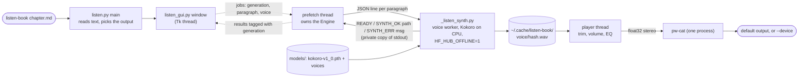
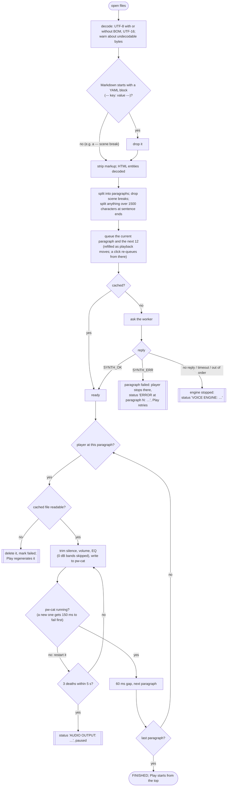
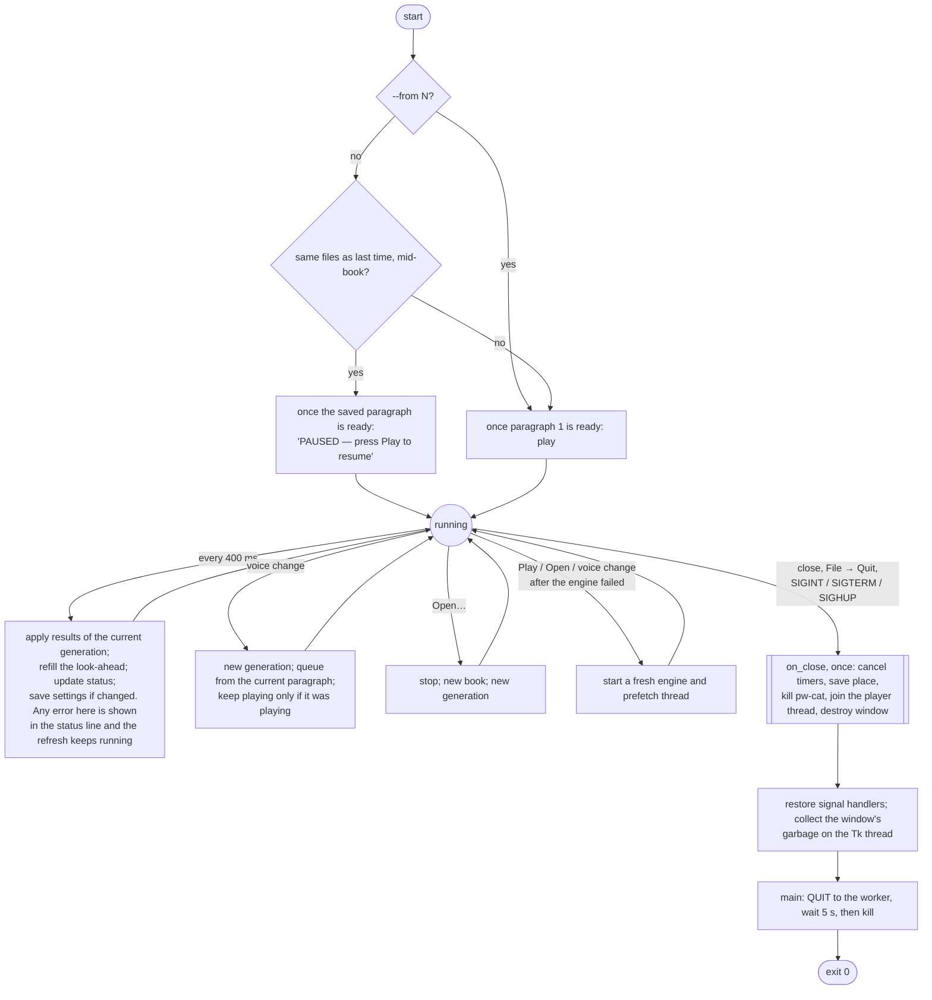
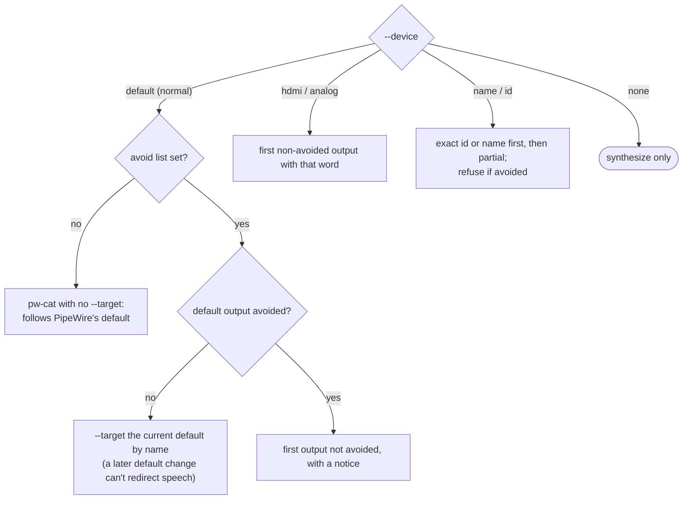

# How Listen Book works

Shapes carry meaning, not color: rounded = start/end, diamond = decision, cylinder = file on disk, double-bordered = error path.

## Processes and threads

- **The window opens at once.** The prefetch thread starts the voice worker in the background, and the status reads `LOADING VOICE ENGINE…` while the model loads (10–60 s on a CPU).
- **The worker protocol** is one JSON line in and one status line out. The worker keeps a private duplicate of its original stdout for protocol lines, and points file descriptor 1 at stderr (`kokoro-worker.err`). Nothing Kokoro, torch or espeak prints, from Python or from C, can reach the reply stream.
- **Reply checks.** The reader skips anything that is not a protocol line, and checks that each `SYNTH_OK` names the file it asked for. A mismatch stops the engine instead of crediting audio to the wrong paragraph.
- **Every read from the worker has a timeout:** `LISTEN_BOOK_STARTUP_TIMEOUT` (300 s) and `LISTEN_BOOK_SYNTH_TIMEOUT` (600 s per paragraph). A hung engine is reported, not waited on forever.
- **Generations.** Every synthesis job carries a generation number. Opening a book or changing the voice starts a new generation, and the window drops results from older ones. Without this, a failure arriving late for the old voice was shown as a failure of the new one.
- **Install-path limit.** espeak-ng, bundled with the voice engine, copies its data path into a 160-byte buffer. A longer path is truncated; espeak falls back to a path from its own build machine and exits the worker. The installer refuses such a prefix, and the worker checks again before loading, which covers an install moved later. A symlink can't work around it, because phonemizer resolves symlinks.

## A paragraph from text to sound

**Why the `pw-cat running?` check exists.** Writes go into a 64 KB pipe buffer, so a write can "succeed" after pw-cat has exited, and the audio goes nowhere.
- **When it fails at once:** a pw-cat that cannot open the output exits within moments. A newly started one therefore gets 150 ms to fail before any audio is trusted to it. That costs 150 ms once per playback start.
- **When it dies later:** the player checks the process after each write.

## Opening and closing the window

**Two details of closing.**
- **pw-cat is killed, not closed and waited for.** If pw-cat stops reading, the player thread blocks in a write to it. Closing its stdin from the Tk thread would then wait on that same write forever, so the window froze on close. Killing it makes the blocked write fail at once.
- **Garbage collection runs on the Tk thread.** A closed window's widgets are cyclic garbage. If the collector freed them in the player or prefetch thread, Tk would abort the process (`Tcl_AsyncDelete: async handler deleted by the wrong thread`).

## Choosing the output

Listen Book reads PipeWire's state with `wpctl status` / `wpctl inspect` and never changes it.

**How an avoid-list entry matches a sink** (case-insensitive):
- the sink's id, node name or description, exactly;
- or, for entries of 4 characters or more, part of its name or description.

An entry that matches no current output gets a warning, since it is probably a typo.

## Test coverage

| Behaviour | Test |
|---|---|
| Markdown, front matter vs an opening `---` scene break, BOM, UTF-16, HTML entities, sentence splitting of long paragraphs | `test_listen.TextTests` |
| Output parsing, default output, avoid list (case, id, partial name, pinned target), id beats partial match | `test_listen.OutputSelectionTests` |
| espeak-ng 159-character path limit, including through a symlink | `test_listen.EspeakPathLimitTests`, `tests/test_install.sh` |
| Corrupt or wrong-typed settings, cache trimming | `test_listen.SettingsTests`, `test_listen.CacheTests` |
| Engine: stray output ignored, hung paragraph and hung startup time out | `test_listen.EngineProtocolTests` |
| Terminal: play per paragraph, `--no-play` + `--out`, `--from/--max`, bad arguments, synth error and engine crash reported | `test_listen.CommandLineTests` |
| Window: plays to FINISHED, Play after FINISHED, voice change after FINISHED, explicit target, look-ahead limit, click far ahead, click behind the look-ahead, `--from`, empty book | `test_gui.PlayerWindowTests` |
| Window errors: synth error, engine crash, Play restarts a crashed engine, engine that cannot start, unreadable cache, late failure for an old voice dropped, corrupt cache regenerated, missing pw-cat, pw-cat dying, close while pw-cat stalls, opens before the engine is ready | `test_gui.PlayerWindowTests` |
| Window settings: place saved, resume paused, corrupt settings, absurd window size, unwritable settings | `test_gui.PlayerWindowTests` |
| SIGTERM to the window: exit 0, place saved, worker gone | `test_gui.WindowSignalTests` |
| Real Kokoro: speaks, all 5 voices, unknown voice is an error not a crash, cache hit, clean QUIT (opt-in) | `test_engine` |
| Installer: foreign prefix, too-long prefix, checkout as prefix, relative prefix, uninstall keeps others' files and menu entries | `tests/test_install.sh` |
| Installer: fresh install, re-run, checksum verification, real engine on the fresh install | by hand (downloads the engine and model) |

During development each regression test was checked by mutation: remove the fix, confirm the test fails.
- **Forward clicks:** the seek re-queue is not what makes them work; the look-ahead refill re-queues from the clicked paragraph within 400 ms anyway.
- **Backward clicks:** the seek re-queue is the only thing that synthesizes the target. `test_click_behind_the_window_is_synthesized` fails without it.
- **The stalled-pw-cat test**, without its fix, hangs rather than failing, since it reproduces the original deadlock.

**Not covered by automated tests:**
- the EQ sliders' audible effect (the filter maths is unit-tested);
- Page Up/Down;
- the file dialog;
- a signal arriving in the instant between starting the worker and recording its process;
- a pause racing a status the player thread is about to write. The player never overwrites a pause, but the window between check and write is microseconds wide and not reproducible on demand.
